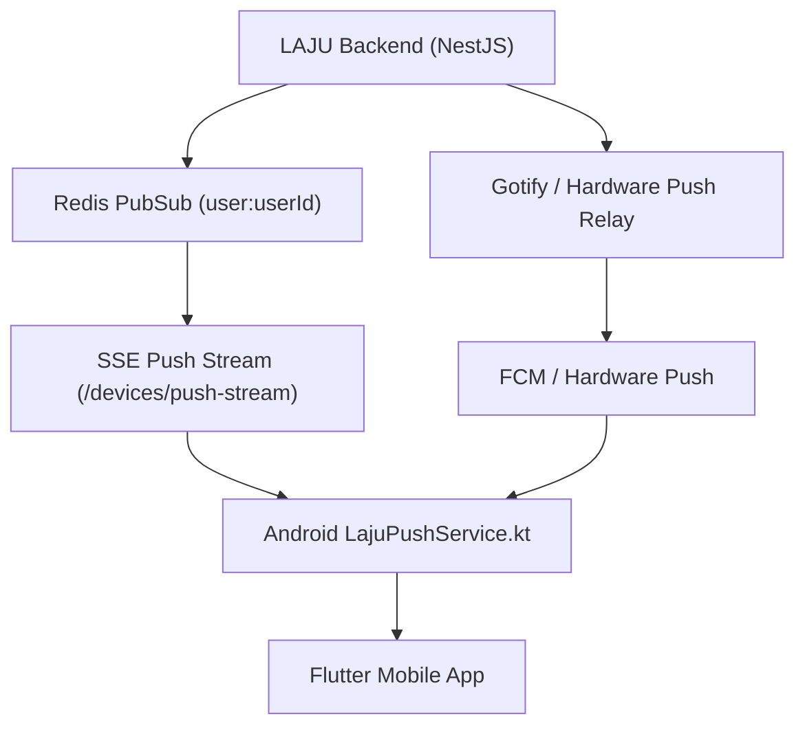

# Mobile Notifications & Background Sync Architecture

Notifications in LAJU are cryptographically decoupled wakeups—never cleartext message transports. The application guarantees timely notification delivery and silent background synchronization even when the device is idle or in Android Doze mode.

---

## 1. Dual Transport Architecture

LAJU combines two complementary channels for reliable event delivery:



1. **Persistent SSE Stream (`GET /devices/push-stream`)**:
   - The primary channel while the device has network connectivity.
   - Long-lived HTTP stream (`Content-Type: text/event-stream`) authenticated via JWT.
   - Subscribes to Redis PubSub channels `user:${userId}` and `announcements:global`.
   - Sends periodic heartbeat pings (`: heartbeat <timestamp>`) every 25 seconds.
2. **Hardware Push Fallback (FCM / Gotify)**:
   - High-priority silent wakeup payload when the device enters deep sleep or the SSE socket is severed.
   - Triggers the native service to re-establish the SSE socket and synchronize unread state.

---

## 2. Catch-Up Replay Mechanism (`?since=`)

When a mobile device reconnects after being offline, in Doze mode, or experiencing intermittent connectivity:

```text
GET /devices/push-stream?since=1729501200000
```

The server automatically scans and replays all missed high-priority events:
1. **Active Ringing Calls**: Calls initiated within the last 60 seconds that are still ringing (`CallParticipant.state == 'RINGING'`).
2. **Missed Calls**: Calls that expired or completed while disconnected, immediately notifying the user.
3. **Unread Message Pointers**: Opaque wakeup events prompting the client to pull encrypted payloads via `/sync`.

---

## 3. Android Native Service: `LajuPushService.kt`

On Android, background execution is orchestrated by a dedicated native service (`apps/mobile/android/app/src/main/kotlin/com/laju/laju_mobile/LajuPushService.kt`):

### A. Silent Background Execution vs Foreground Contract
- **Contract Fulfillment**: On Android 8.0+ (Oreo), `startForegroundService` is called to comply with OS requirements, using a low-priority silent channel (`laju_sync`, notification ID `9001`).
- **Immediate Dismissal**: As soon as the service binds and registers its network callback, `stopForeground(STOP_FOREGROUND_REMOVE)` and `nm.cancel(9001)` are executed immediately. This guarantees that **zero persistent notifications clutter the status bar or notification drawer**.

### B. Doze Mode & WakeLock Management
- For incoming WebRTC calls, the service acquires a `PowerManager.SCREEN_BRIGHT_WAKE_LOCK` or `ACQUIRE_CAUSES_WAKEUP` with a **strict 10-second hard safety timeout** (`callWakeLock.acquire(10000L)`).
- This ensures the device screen wakes up to present incoming calls without risking battery drain if the user does not respond.

### C. Foreground Duplicate Suppression
- When `MainActivity.isAppInForeground == true`, the service **suppresses system heads-up notifications** for calls.
- Instead, the event is dispatched directly to the active Flutter view to render a smooth, non-blocking in-app floating banner.
- If the device is locked or in another application, the service fires a full-screen intent notification (`NotificationCompat.Builder.setFullScreenIntent`) with high priority.

---

## 4. Notification Channels Configuration

| Channel ID | Name | Importance | Sound | Vibration | Purpose |
| :--- | :--- | :--- | :--- | :--- | :--- |
| `laju_calls` | Panggilan Masuk | `IMPORTANCE_HIGH` | Ringtone | Yes | Incoming WebRTC voice & video calls |
| `laju_messages` | Pesan Obrolan | `IMPORTANCE_DEFAULT` | Chime | Yes | Normal chat notifications |
| `laju_sync` | Sinkronisasi Latar Belakang | `IMPORTANCE_LOW` | None | No | Silent background sync (immediately dismissed) |

---

## 5. Privacy Payload Constraints

Notification payloads must remain opaque:
- **Allowed**: `conversation_id`, `sender_id`, `type: "message_available"`, `call_id`.
- **Prohibited**: Plaintext message body, image/media previews, cryptographic keys, attachment URLs, or live location coordinates.
