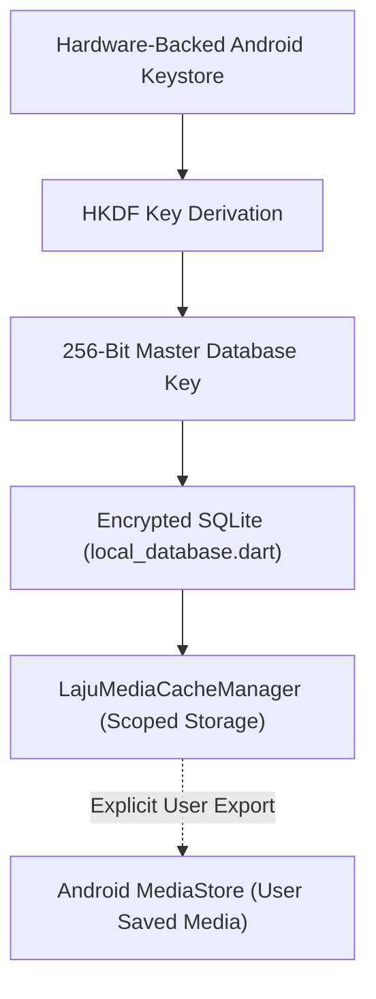

# Mobile Storage & Media Caching Architecture

The mobile application (`apps/mobile`) stores state across two distinct encrypted tiers: relational data in an encrypted SQLite database, and media binaries in an isolated disk cache.

---

## 1. Storage Tiers

1. **Encrypted SQLite (`local_database.dart`)**:
   - Stores conversation threads, participant metadata, message delivery sequences, draft messages, and local security events.
   - Database key is derived from the hardware Android Keystore via HKDF-SHA256 and never stored in cleartext on disk.
2. **Encrypted Media Cache (`laju_media_cache_manager.dart`)**:
   - Manages downloaded images, video attachments, voice notes, stickers, and status media in app-specific scoped storage (`context.cacheDir` / `context.filesDir`).
   - Automatically prunes aged cache files to prevent excessive disk consumption.
   - Excluded from cloud backups via Android Auto-Backup rules (`backup_rules.xml`).
3. **Android MediaStore Gallery Export**:
   - When a user explicitly chooses "Simpan ke Galeri" (Save to Gallery), media is written to the public `MediaStore.Images` / `MediaStore.Video` directory using standard Android 10+ scoped storage APIs.
   - Eliminates the need for legacy deprecated runtime storage permissions (`WRITE_EXTERNAL_STORAGE`).

---

## 2. Emergency Storage Erasure

During account deletion (`DELETE /users/me`) or remote incident containment:
- All SQLCipher database tables are vacuumed and zeroed before the `.db` file is deleted.
- All cached media files in the app sandbox are recursively deleted.
- Cryptographic keys in Android Keystore are permanently destroyed.
