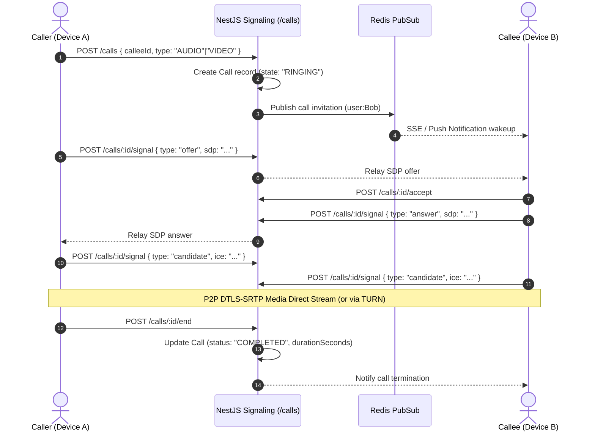

# Voice and Video Calls Protocol

LAJU uses standard **WebRTC (Web Real-Time Communication)** for end-to-end encrypted peer-to-peer audio and video transmission, coordinated via NestJS signaling relays.

---

## 1. Call Signaling Architecture

---

## 2. Invariants & Timeout Rules

1. **60-Second Auto-Expiration**:
   - If an incoming call is unanswered after 60 seconds (`now() - createdAt > 60s`), the server automatically transitions the participant to `state: 'MISSED'` and terminates the session.
   - When the callee device reconnects via SSE (`/devices/push-stream?since=`), missed calls are automatically replayed into local call history.
2. **Dual-Path Media Relay (Fallback)**:
   - **Primary**: Direct P2P via STUN NAT traversal.
   - **Secondary**: Relay through authenticated TURN servers (RFC 5766). Media streams over TURN remain fully SRTP encrypted; the server never holds decryption keys.
   - **Low-Bandwidth Fallback**: `/calls/:id/audio-chunk` and `/calls/:id/video-frame` allow degraded frame transmission under extreme packet loss networks.
3. **Group Calling**:
   - Initiated via `POST /calls/group` with `conversationId`.
   - Ringing broadcasted to all active group members.
   - Participants join asynchronously (`POST /calls/:id/accept`) and exchange mesh peer connections.

---

## 3. Backoffice & Telemetry Constraints

The Backoffice only tracks operational connection metadata:
- Call ID, initiator ID, participant count.
- Status (`RINGING`, `CONNECTED`, `COMPLETED`, `REJECTED`, `MISSED`, `CANCELLED`).
- Call duration in seconds and network error codes.
- **Strict Prohibition**: The platform does not record, buffer, or inspect live audio/video streams.
